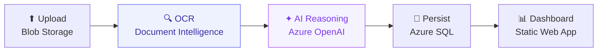
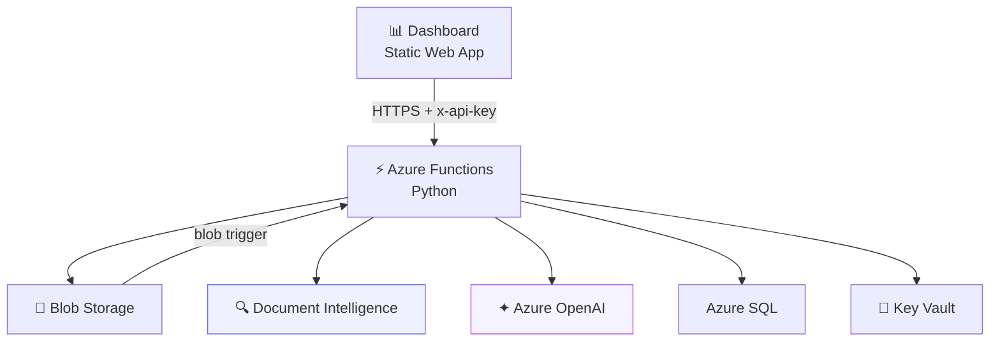

# AI Document Processing (IDP) — AI-First Document Pipeline

An AI-first, event-driven pipeline that classifies, extracts, and summarizes
financial documents (KYC identity, invoices, service applications) using two
Azure AI services — **Azure AI Document Intelligence** (OCR / field extraction)
and **Azure OpenAI** (`gpt-4.1-mini`) — deployed with **Terraform** + **GitHub
Actions** and served by a **Static Web App** dashboard on
`azure-ai-doc.techcloudup.com`.

> **Status**: deployed and running end to end.

## The AI core

Two machine-learning services do the heavy lifting, each with a different ML approach:

| | Reader | Reasoner |
|---|---|---|
| **Service** | Azure AI Document Intelligence | Azure OpenAI · `gpt-4.1-mini` |
| **Role** | OCR + structured field extraction | Classification, summarization, risk & missing-field detection |
| **ML approach** | 🧠 Supervised deep learning (CNN + transformer vision/layout models) | ✦ Large language model (transformer, self-supervised + RLHF) |

This project does not train its own models — it calls these pre-trained, managed
AI services for **inference only**.

## How it works



1. **Ingestion** — upload via drag-and-drop or REST API; validated (PDF/PNG/JPEG, ≤ 4MB, ≤ 2 pages); stored in Blob Storage; a blob event triggers the Azure Function.
2. **🔍 Document Intelligence (OCR)** — `prebuilt-idDocument` / `prebuilt-invoice` / `prebuilt-read` extract text and structured fields with per-field confidence.
3. **✦ Azure OpenAI (AI reasoning)** — `gpt-4.1-mini` classifies the document, writes a summary, detects risk signals and missing fields, and returns a confidence score as strict, validated JSON (`temperature = 0.2`).
4. **Persistence** — results written to Azure SQL (`Documents`, `ExtractionResults`, `AIInsights`); PII is masked before storage.
5. **Dashboard** — a live pipeline stepper (Upload → OCR → AI → Done), confidence gauge, key fields, and risk/missing-field flags.

## Architecture



Secrets live in Key Vault and are accessed via Managed Identity; observability
is handled by Application Insights.

## Technology stack

| Layer | Technology |
|---|---|
| 🔍 AI — OCR | Azure AI Document Intelligence |
| ✦ AI — reasoning | Azure OpenAI · `gpt-4.1-mini` |
| ⚡ Compute | Azure Functions (Python, serverless) |
| 💾 Storage | Azure Blob Storage + Azure SQL |
| 🔐 Secrets | Key Vault + Managed Identity |
| 🖥 Front-end | Static Web App |
| 🧱 Infrastructure | Terraform |
| 🚀 CI/CD | GitHub Actions (OIDC) |

## Repository layout

```
├── PRD.md                      # Product requirements (authoritative)
├── docs/
│   ├── implementation-checklist.md  # ★ ordered build steps
│   ├── architecture.md         # components + ADRs
│   ├── deployment.md           # runbook / ops
│   ├── security.md             # secrets / auth / PII
│   ├── api-spec.md             # API + OpenAPI
│   └── data-model.md           # SQL schema
├── infra/                      # Terraform (centralus, idp-prototype RG)
├── src/                        # Azure Functions (Python 3.11)
├── web/                        # Static Web App dashboard (dashboard / how-it-works / about / docs)
└── .github/workflows/          # terraform plan/apply + function/web deploy
```

## Quick start

```bash
# 1. Configure
cp infra/terraform.tfvars.example infra/terraform.tfvars   # set unique_suffix

# 2. Bootstrap remote state (one-time) — see checklist §4

# 3. Provision infrastructure
cd infra && terraform init && terraform plan && terraform apply

# 4. Apply schema, set CORS, deploy — see checklist §8–§15
```

Full step-by-step: **`docs/implementation-checklist.md`**.

## Key decisions

- **Dashboard on Static Web App** — supports custom domains + TLS (App Service F1 cannot).
- **Azure OpenAI `gpt-4.1-mini` (GlobalStandard, `centralus`)** — the reasoning model.
- **Manual Cloudflare DNS** for `azure-ai-doc.techcloudup.com`.

## Security

Secrets in Key Vault, accessed via Managed Identity; CI/CD uses OIDC; synthetic
data only; PII masked before storage. See `docs/security.md`.
